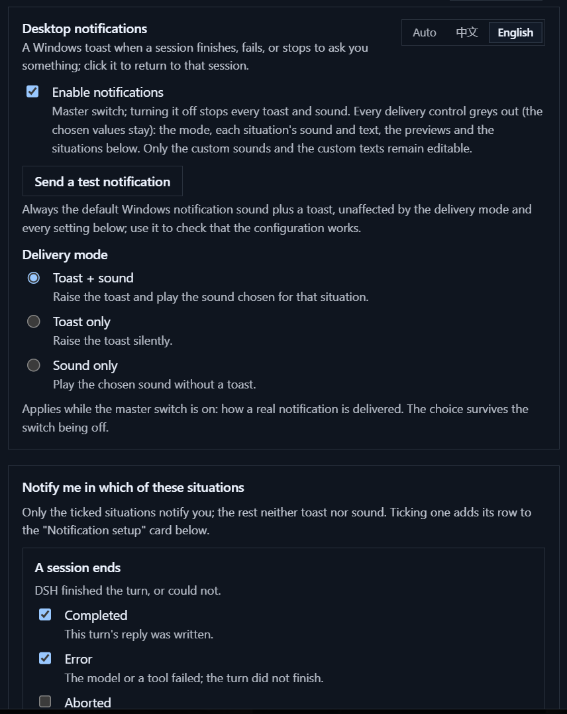
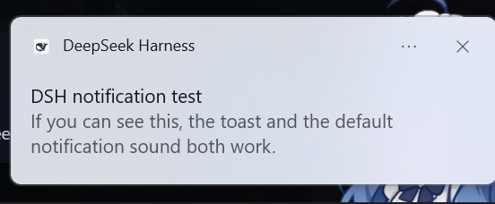
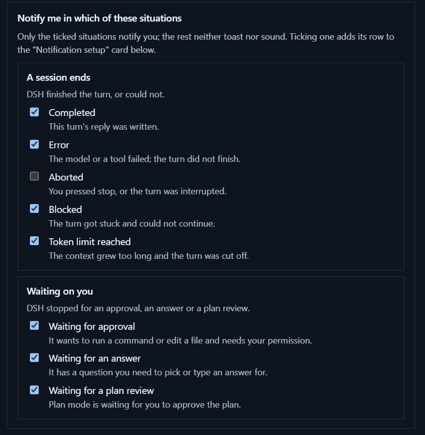
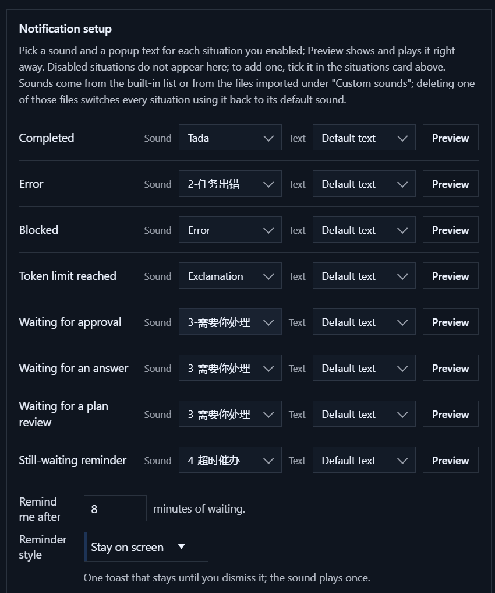

# dsh-notify-desktop

[](https://www.npmjs.com/package/dsh-notify-desktop) · [中文文档](README.zh.md) · English

Windows toast notifications for the DSH desktop app. A session finishes, fails, or stops to ask you
something — you get a native notification with a sound and a piece of text chosen for that situation, and
clicking it brings the DSH window back to the front.



## What's new in 0.2.4

- **Non-wav custom sounds play again.** 0.2.3 started transcoding into a `.part` file and forgot to name the output
  format; ffmpeg cannot infer a container from that suffix, so mp3 / flac and friends went silent and no cache was
  written. Fixed, and the host now records a child that exits abnormally in the diagnostics ring
  (`GET /dsh-notify/debug`) instead of failing silently.
- **Custom sounds can be renamed** from the "Custom sounds" card, Chinese names included; every situation using the
  file follows the new name.
- **Compatibility.** Verified on DSH desktop **0.2.2-rc.1** (plugin loading, projection delivery, host
  toast, diagnostics and text-template routes). The declared range is unchanged (`>=0.2.0-rc.2 <0.3.0-0`).

## What you get

- **Told when it matters** — turn ends (completed, error, aborted, blocked, max-tokens), approval
  requests, questions, plan reviews, and one nudge for a wait that drags on.
- **Quiet when you are there** — nothing pops while the DSH window has focus, and each event notifies
  once (three-second de-duplication).
- **A sound and a text per situation** — nine situations (five turn ends, three waits, one reminder),
  each with its own sound and its own popup text; each situation can store up to three custom texts, and
  every row has a Preview button that shows and plays exactly what it will do.
- **Bilingual** — the plugin's own interface and popup text switch between Chinese and English, either
  pinned or following the DSH language.
- **Three delivery modes** — toast + sound, toast only (silent), sound only (no toast).
- **Your own sounds and words** — sounds come from the Windows library, the author sounds shipped in
  [`sounds/`](sounds/), or files you import; texts have a name, a title, a body and placeholders, live in a
  local JSON file, and can be edited or deleted (with an inline confirmation).
- **Never a long ring** — a file sound stops after eight seconds, and stops at once when you mute
  notifications or come back to the window.
- **Click to come back** — the toast raises the DSH window; it deliberately does not jump to the session.

Requirements: Windows and the DSH desktop app (profile `desktop`), runtime 0.2.x. `ffmpeg` on `PATH` is
optional and only used to transcode custom sounds that are not `.wav`.

## Install

### From npm

```powershell
& "<DSH desktop install>\resources\runtime\cli\bin\dsh.cmd" plugin --profile desktop add dsh-notify-desktop
```

Then restart the DSH desktop app and open **Settings → Notifications** (`Ctrl+,` while focused).

### From a local checkout

1. Clone this repository somewhere permanent — the profile links to that folder.
2. Register it with the desktop app's own CLI:

   ```powershell
   & "<DSH desktop install>\resources\runtime\cli\bin\dsh.cmd" plugin --profile desktop add "link:<path-to-this-repo>"
   ```

3. Restart the DSH desktop app, then open **Settings → Notifications** (`Ctrl+,` while focused).

## Settings

The section has three cards. Preferences live in the renderer's `localStorage`; sounds and texts live on
this machine; every change applies immediately.

**Card 1 — Desktop notifications: whether and how:**

| Control | What it does |
|---|---|
| Enable notifications | Master switch; nothing toasts or sounds while it is off. Every delivery control greys out (the chosen values stay): the mode, each situation's sound and text, the previews, the reminder minutes and the situation switches below. Only "Custom sounds" and "Custom texts" stay editable |
| Send a test notification | Right below the master switch; always the default Windows sound plus a fixed toast, unaffected by the mode and every setting below — use it to check that the configuration works |
| Delivery mode | Toast + sound (default) / Toast only (silent) / Sound only (no toast) |
| Language | Top-right of the card: **Auto** (follow the DSH language) / **中文** / **English**. Only the plugin's own copy and popup texts change; the rest of DSH keeps its language |


What "Send a test notification" raises:



**Card 2 — Notify me in which of these situations:**

| Group | Switches |
|---|---|
| A session ends | Completed / Error / Aborted / Blocked / Token limit reached (each row carries an example) |
| Waiting on you | Waiting for approval / an answer / a plan review (each row carries an example) |



**Card 3 — Notification setup: the sound and text of each situation:**

| Control | What it does |
|---|---|
| Situation row | Only the situations ticked in card 2 appear (rows follow the ticks live). Each row is: situation name + sound picker + text picker + Preview |
| Preview | Shows and plays that situation's current text (the default text is rendered with sample values) and sound, following the delivery mode |
| Sound picker | Two levels: the source first (Windows / author / custom), that source's sounds second |
| Text picker | Two levels: **Default** (built-in wording) or **Custom** (that situation's saved texts, listed by name) |
| Custom sounds (collapsible) | Add / list / rename / remove your sound files; the transcode cache and its clear button live here too |
| Custom texts (collapsible) | Manage the saved texts per situation: at most three each, with a name, a title and a body, an Edit button and a red Delete button (deletion is confirmed inline) |

Ticking a situation makes its row appear in the "Notification setup" card below; unticking it only hides the
row and keeps its sound and text, so ticking it again brings them back.



## Sounds

**Three sections.** Every sound picker opens a two-level list: the source first, that source's sounds second.

- *Windows sounds* — twenty built-in choices: the five toast events plus the media library
  (`chimes`, `ding`, `tada`, `Windows Error`, `Critical Stop`, `Alarm0x`, `Ring0x`, …).
- *Author sounds* — the four `.wav` files in [`sounds/`](sounds/). Drop another file in that folder and
  it appears; no code change is involved.
- *Custom sounds* — your own imports.

**Your own files.** *Add sound…* copies the file into `%LOCALAPPDATA%\dsh-notify\custom`, so the
original can move or be deleted afterwards. Accepted formats are `.wav`, `.mp3`, `.m4a`, `.aac`,
`.wma`, `.flac`, `.ogg` and `.opus`. Deleting a custom sound asks for confirmation first.

**Other formats need ffmpeg first.** The plugin plays audio through Windows' `SoundPlayer`, which only opens wav;
an mp3, m4a or flac has to be turned into a wav with `ffmpeg` first. Nothing breaks without it: wav files and the shipped
sounds still play, other formats stay silent, and the "Custom sounds" card shows a yellow line saying what is missing.

Pick whichever is easiest (winget ships with Windows 10/11):

```powershell
winget install Gyan.FFmpeg     # recommended
choco install ffmpeg           # if Chocolatey is installed
scoop install ffmpeg           # if Scoop is installed
```

You can also download a build from [ffmpeg.org](https://ffmpeg.org/download.html) or
[gyan.dev](https://www.gyan.dev/ffmpeg/builds/) and put `ffmpeg.exe` anywhere on your `PATH`. It works as soon as you
come back to the settings page — **no DSH restart**.

The transcode happens on that format's **first play** only: measured 0.1–0.3 s for anything from five seconds to five
minutes, and every later play reads the cache. The cache is uncompressed wav — about **10 MB per minute** — so short
sounds are the sane choice; "`Custom sounds → Transcode cache`" shows how much it takes and clears it without touching
the sounds themselves.

**When a sound stops.** A `.wav` plays directly. Anything else is transcoded once with the `ffmpeg` on
your `PATH` and lands in the transcode cache inside "Custom sounds", which reports its size and can clear
it. File sounds are capped at eight seconds, and a sound already playing stops immediately when you switch
notifications off, switch to "Toast only", or when the DSH window regains focus. Without ffmpeg, wav files
and the two shipped libraries still work; the diagnostics route reports `media.ffmpeg: null`.

**Why custom sounds exist.** A toast can only reference five `ms-winsoundevent` values, and on Windows 11
those resolve to four very similar chimes — `Notification.IM` and `Notification.SMS` are literally the
same file. Playing the audio from the host is the only way to get sounds that are actually distinguishable.

## Popup texts

**One text per situation.** A real notification's title and body come from the text that situation has
selected: the **default text** (built-in `{工作区} · {状态}` / `{内容}`, nothing to configure), or a **custom
text** saved for that situation. Each situation keeps at most **three** custom texts.

**The editor.** Name (24 characters), title (120), body (300); the placeholders `{工作区}` `{状态}` `{内容}`
`{分钟}` are insertable with one click, and a live preview line renders the template while you type.

**Test vs preview.** The test button in card 1 always uses fixed copy and the default Windows sound; the
Preview button in card 3 uses the situation's real text and sound (following the delivery mode). An empty
`{内容}` falls back to that situation's built-in line.

**Where they live.** The wording is stored in
`%LOCALAPPDATA%\dsh-notify\templates\templates.json` (under the same `dsh-notify` folder as the custom
sounds), grouped by situation, at most three per situation; writes go through a temp file plus a rename,
and a corrupt file reads as an empty library instead of crashing. The settings store only the chosen id;
when a template is deleted the situation falls back to the default text. **Restart the app after editing
this file by hand** — the client loads it once at start-up.

## Compatibility

| | |
|---|---|
| Verified on | DSH desktop **0.2.2-rc.1**: plugin loading, projection delivery, host toast, diagnostics and text-template routes, plus the settings page's Chinese/English switch ([evidence](docs/acceptance/2026-11-06-bilingual-ui.md)); earlier runs — 0.2.1-rc.5 (toast identity) and rc.3 / rc.2 / 0.2.0-rc.2 — are kept in `docs/acceptance/` |
| Declared range | `>=0.2.0-rc.2 <0.3.0-0` (the loader's semver gate) — this lets the loader **accept** the whole 0.2 line from 0.2.0-rc.2 on, prereleases included; **only the versions verified above are tested — anything else inside the range is allowed but not guaranteed**. 0.2.0-rc.1 and older, and 0.3.x, are outside it |
| Platform | Windows desktop profile only; the web profile has no toast channel and is untested |
| Seam check | The 0.2.2 runtime image ships no `.d.ts`; every seam used here was checked against its compiled JS and still matches |

The compatibility claim lives in both `dsh.engines.dsh` and `peerDependencies.@deepseek-ai/dsh` (kept
identical). The loader checks it with `semver.satisfies(runtime, range, { includePrerelease: true })`; a
mismatch makes it skip the plugin rather than load it. On another runtime, grant an exemption:

```powershell
dsh.cmd plugin --profile desktop allow-version dsh-notify-desktop@0.2.1 --dsh-version <your-version> --accept-risk
```

## How it works

Two halves, and no harness code is modified.

- The **host half** registers one session projection (`notify`) and a few same-origin routes; it also
  owns the text-template file (atomic write, per-situation cap and length validation).
- The **client half** reads that projection from the session list, decides whether a notification is
  warranted, composes the situation's sound and text, and sends it: a host PowerShell toast while the
  window is unfocused, the renderer's own notification as the fallback.

Questions arrive from two places on purpose, and neither can be dropped. Questions asked as tool calls
reach the projection; service-level asks such as the plan review never enter the session log, so the host
observes the `user-questions/request` waterfall with `{ global: true }` and hands them to the client over
a bounded queue. A cross-source key keeps the two copies from double-toasting.

| Route | Purpose |
|---|---|
| `GET /dsh-notify/debug` | Projection state, recent client reports, ffmpeg and player status |
| `POST /dsh-notify/toast` | Raise one toast (title, body, sound id) |
| `POST /dsh-notify/focus` | Raise the window through `dsh://open` |
| `POST /dsh-notify/silence` | Stop the sound that is playing |
| `GET/POST /dsh-notify/sound-library` | List the two library folders |
| `POST /dsh-notify/import-sound`, `/delete-sound` | Add or remove a custom sound |
| `GET/POST /dsh-notify/sound-cache` | Report or clear the transcode cache |
| `GET/POST /dsh-notify/text-templates` | Read every saved text; save or delete one |
| `POST /dsh-notify/pick-file`, `GET /dsh-notify/foreground` | Windows file picker; OS-level focus answer |
| `GET /dsh-notify/questions` | Poll the host-side question queue |

**Toast identity fallback.** The desktop app may be registered for notifications under either of two
AppUserModelIDs: newer builds use `com.deepseek.dsh`, older ones Electron's default
`electron.app.DeepSeek Harness`. Nothing is hard-coded: before raising a toast the host child probes the
candidates (`CreateToastNotifier(...).Setting` non-null means the identity is registered), prefers the
legacy id because Windows resolves its display name and icon, and falls back to the manifest id; the
chosen identity is logged in the diagnostics route. To
force a list, set `DSH_NOTIFY_AUMID=id1;id2` before starting the desktop app (semicolon-separated,
tried in order).

## Troubleshooting

Windows toasts never reach the Action Center, so the diagnostics route is the only evidence channel.
The port can change per launch — use the one in the desktop app's current web address:

```powershell
Invoke-WebRequest http://127.0.0.1:<desktop-port>/dsh-notify/debug
```

It returns the projection registration state, the last 40 client reports (every decision, channel choice
and platform result), and the sound plumbing (`media.ffmpeg`, `media.soundPlayers`). Every host toast also
logs one `host-toast aumid=… candidates=…` line, which shows the identity it actually used.

## Development

```powershell
pnpm install
pnpm run check      # typecheck + vitest + build
```

`lib/` is committed on purpose: the profile links to this folder, so the built bundles ship with the
source. [AGENTS.md](AGENTS.md) holds the repository rules and the measured constraints that must not be
"optimised" away — the host bundle stays self-contained, the toast spawn keeps piped stdio, and audio goes
through `System.Media.SoundPlayer` only.

## Known limits

- No tray badge, taskbar badge or window flashing; those need main-process APIs a plugin cannot reach.
- Clicking a toast raises the window, it does not navigate to the session.
- The `error` and `max-tokens` turn ends are covered by unit tests only; they were never reproduced live.
- A toast cannot be observed being dismissed, so file sounds are capped rather than tied to the toast.
- A custom text belongs to exactly one situation; using the same wording in two situations means saving it
  twice. Hand-edited template files are only re-read after an app restart.
- Windows desktop profile only.

## License

[MIT](LICENSE) · third-party notices in [THIRD-PARTY-NOTICES.md](THIRD-PARTY-NOTICES.md).

Unofficial plugin: not affiliated with, endorsed by, or sponsored by DeepSeek. "DeepSeek", "DSH" and
"DeepSeek Harness" are used descriptively, to say what this plugin plugs into.
