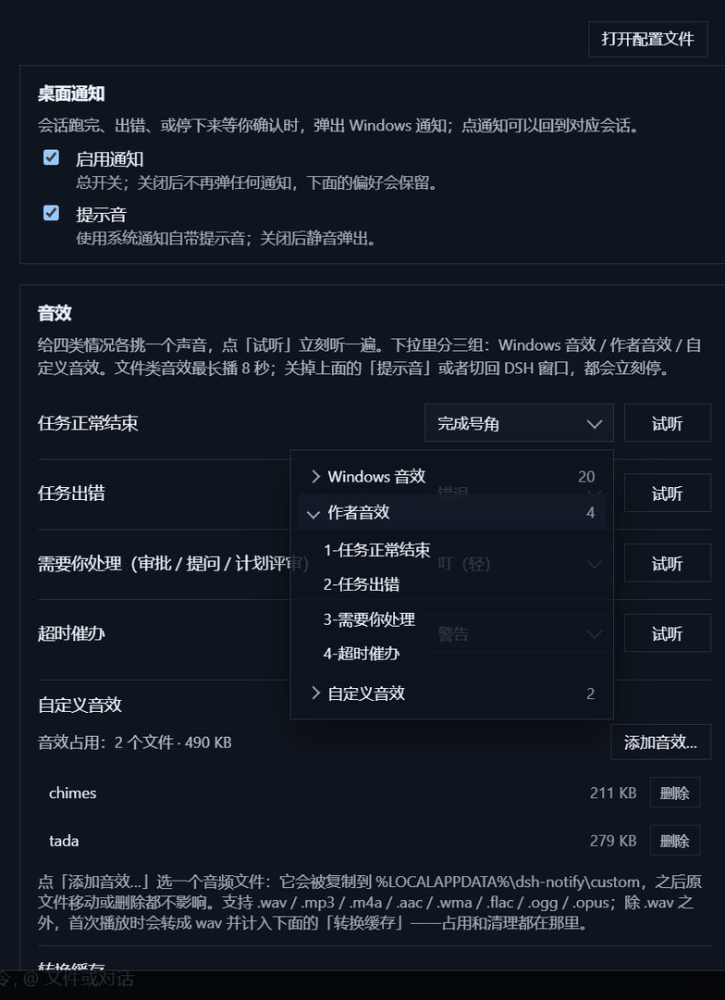

# dsh-notify-desktop



给 **DSH 桌面端** 加 Windows 原生通知：会话跑完、出错、或停下来等你确认时弹出系统通知，并**按情况播放你挑选的音效**。
点通知把 DSH 窗口拉回前台。

[English](README.md)

> **非官方插件**：与 DeepSeek 官方无关，未获其背书或赞助。所用第三方许可见
> [THIRD-PARTY-NOTICES.md](THIRD-PARTY-NOTICES.md)。

## 兼容性

| | |
|---|---|
| **实测版本** | DSH 桌面端 **0.2.0-rc.2**（当前正式运行时）。下面每个场景都跑过真机，证据在 [docs/acceptance](docs/acceptance/2026-10-10-desktop-e2e.md)。 |
| **声明范围** | `>=0.2.0-rc.2 <0.3.0-0` —— 即「0.2 线」，含预发布版。 |
| **平台** | **仅 Windows 桌面端 profile**。web profile 未验证：它没有 Windows Toast 通道可用。 |
| **0.2.1-alpha.2** | 未做真机验证。已把它在 npm 上发布的**类型声明**与本机 rc.2 逐行对比：本插件用到的 seam 完全一致，差异只有新增。 |

**DSH 的判定机制**（读源码确认）：profile 加载器只看 `peerDependencies` 里名字为 `@deepseek-ai/dsh`
或 `@deepseek-ai/dsh-*` 的条目，用
`semver.satisfies(runtimeVersion, range, { includePrerelease: true })` 判定；**不匹配会直接跳过该插件**（不加载）。
运行时不在范围内时，可以等插件更新，或显式豁免：

```powershell
dsh.cmd plugin --profile desktop allow-version dsh-notify-desktop@0.1.0 --dsh-version <你的版本> --accept-risk
```

（`package.json` 里的 `dsh.engines.dsh` 只是元数据，加载器**不读它**。）

## 什么情况会通知

| 情况 | 细节 |
|---|---|
| 回合结束 | `completed` / `blocked` / `max-tokens`，以及各自独立开关的 `error` 与 `aborted` |
| 等待审批 | `approval/asked` → `approval/decided` |
| 等待回答 | `ask_user_question`，**包括从 `run_code` 里发起的提问**（PTC dispatch）|
| 计划评审 | 计划模式的 `interaction.ask()` |
| 一直没人理 | 阻塞交互超过阈值后补一条催办（默认 10 分钟，可改）|

**行为语义**：边沿触发；按「回合号 / 请求 id」做 3 秒去重；**窗口有焦点时完全不弹**（看不见的通知就是噪音）。
点通知通过应用自己的 `dsh://open` 协议把窗口拉回前台，**刻意不跳转会话** —— 那是更可预测的行为。

## 音效

四类情况可以各不相同 —— **正常结束 / 出错 / 需要你处理 / 超时催办** —— 每类一个下拉加一个「试听」按钮。
每个下拉分三组：

- **Windows 音效** —— 内置 20 个（5 个通知事件 + 系统媒体库：`chimes`、`ding`、`tada`、
  `Windows Error`、`Critical Stop`、`Alarm0x`、`Ring0x` 等）。
- **作者音效** —— 本仓库 [`sounds/`](sounds/) 里的 4 个 `.wav`，四类情况各一个；**再往那个文件夹丢文件就等于加音效**，不用改代码。
- **自定义音效** —— 你自己导入的，见下。

**自定义音效**：点「添加音效…」会把选中的文件**复制**进
`%LOCALAPPDATA%\dsh-notify\custom` —— 原文件之后移动或删除都不影响，可以放多个，也能在列表里逐个删除。
支持 `.wav` / `.mp3` / `.m4a` / `.aac` / `.wma` / `.flac` / `.ogg` / `.opus`。`.wav` 直接播放；
其他格式首次播放时用 PATH 上的 `ffmpeg` **转码一次**，占用计入列表下面的**「转换缓存」**（在那里查看与清理，
下次播放自动重建）。没有 ffmpeg 时，wav 与随插件发布的音效照常可用，诊断接口会显示 `media.ffmpeg: null`。

**声音什么时候停**：文件类音效**最长播 8 秒**；正在播放时，关掉「提示音」总开关、或窗口重新获得焦点
（点通知也是这个效果），声音**立刻停**。

**为什么要做「自定义文件」**：Toast 只能引用 5 个 `ms-winsoundevent` 事件，而在 Windows 11 上它们只对应
4 个**彼此很像**的「叮」—— `Notification.IM` 与 `Notification.SMS` 甚至是同一个 wav。想让四类情况
真的听得出差别，只能由宿主自己播放音频。

## 安装

1. 把本仓库 clone 到一个**固定的长期目录**（profile 以链接方式指向它，之后别挪动）。
2. 用桌面端自带 CLI 注册（`link:` 形式，本体留在你 clone 的位置）：

   ```powershell
   & "<DSH 桌面端安装目录>\resources\runtime\cli\bin\dsh.cmd" plugin --profile desktop add "link:<本仓库路径>"
   ```

3. 重启 DSH 桌面端（宿主半侧在启动时加载）。
4. 打开 **设置 → 通知**（窗口有焦点时按 `Ctrl+,`），确认段落出现。

## 设置项

- **启用通知** —— 总开关，关掉后一律不弹。
- **提示音** —— 一次性静音所有音效组。
- **音效** —— 四类情况各一个下拉 + 试听。
- **自定义音效文件** —— 粘贴路径，或点「浏览…」用 Windows 选择框。
- **转换缓存** —— 显示转码 wav 的占用，并提供「清理缓存」。
- **结束提醒** —— 每种回合结束原因一个开关。
- **等待确认** —— 每种阻塞交互一个开关。
- **催办** —— 多少分钟后补一条；**测试按钮**可立刻弹一条。

偏好存在渲染层 `localStorage` 的 `dsh-notify-desktop.v1` 里，改完立即生效，不需要重启。

## 架构

插件分两半，**不改 harness**。

- **宿主半侧**（`src/index.ts`、`src/projection.ts`、`src/questions.ts`）：注册一个会话投影
  （`notify`）和若干同源路由。
- **客户端半侧**（`src/client/**`）：从会话列表读投影、判断该不该通知、然后发出去 —— 窗口失焦时走
  **宿主 PowerShell Toast**，路由不可达时退回渲染层的 `Notification`。

**提问为什么有两个来源（都不能删）**：工具调用式提问能进投影；而服务级提问（计划评审）**根本不进会话日志**
—— 宿主用 `{ global: true }` 监听 `user-questions/request` 瀑布，经有界队列交给客户端轮询。跨源去重键
保证不会重复弹两条。

| 路由 | 用途 |
|---|---|
| `GET /dsh-notify/debug` | 投影状态 + 客户端最近上报 + ffmpeg/播放器状态 |
| `POST /dsh-notify/toast` | 弹一条通知（标题、正文、音效 id）|
| `POST /dsh-notify/focus` | 通过 `dsh://open` 把窗口拉回前台 |
| `POST /dsh-notify/silence` | 停掉正在播放的声音 |
| `POST /dsh-notify/pick-file` | Windows 音频文件选择框 |
| `GET/POST /dsh-notify/sound-cache` | 查询 / 清理转码缓存 |
| `GET /dsh-notify/questions` | 轮询宿主侧提问队列 |

## 诊断

```powershell
Invoke-WebRequest http://127.0.0.1:19387/dsh-notify/debug
```

Windows 通知**不进操作中心**，所以这是唯一的证据通道：返回投影注册状态 + 客户端最近 40 条上报
（每条决定、通道选择、平台结果）。

## 开发

```powershell
pnpm install
pnpm run check      # typecheck + vitest + build
```

`lib/` 是**故意提交**的：profile 链接的就是这个目录，构建产物随源码一起走。仓库规则、以及那些**不许
"优化"掉**的实测约束（宿主 bundle 必须自包含、Toast 子进程必须保留管道 stdio、音频只能走
`System.Media.SoundPlayer`）都写在 [AGENTS.md](AGENTS.md)。

## 已知限制

- 没有托盘角标 / 任务栏角标 / 窗口闪烁 —— 那些需要主进程 API，插件够不到。
- 点通知只把窗口拉回前台，不跳转会话。
- `error` 与 `max-tokens` 两个结束态只有单测覆盖，没有真机构造过。
- 插件**无法感知通知被关闭**，所以文件类音效用的是「封顶 8 秒」而不是跟随通知生命周期。
- 仅支持 Windows 桌面端 profile。

## 许可证

[MIT](LICENSE)
